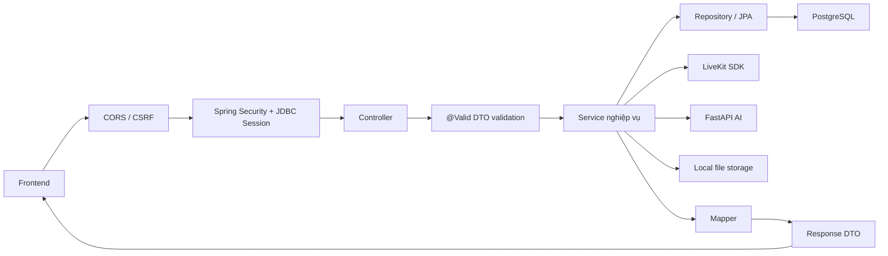

# CUSC Smart Meeting Service

# http://localhost:8080/actuator/health

# http://localhost:8080/swagger-ui/index.html

<!-- mvn clean package -DskipTests
mvn spring-boot:run -->

Backend Spring Boot cho `CUSC Smart Meeting`.

## Architecture

Frontend
-> Java `meeting-service`
-> PostgreSQL
-> LiveKit
-> FastAPI

FastAPI
-> subscribe audio trực tiếp từ LiveKit
-> STT / AI
-> callback kết quả về Java

Java không xử lý `AudioFrame`.

## Requirements

- Java 17
- Maven 3.9+
- PostgreSQL
- LiveKit server

## Database

Local PostgreSQL mặc định:

- DB: `meeting_db`
- User: `meeting_user`
- Password: `meeting_password`

Override bằng env:

- `DB_URL`
- `DB_USERNAME`
- `DB_PASSWORD`

Docker dev:

```bash
docker compose -f docker-compose.dev.yml up -d
```

## Run

```bash
mvn clean test
mvn clean package
mvn spring-boot:run
```

Nếu cần workspace-local Maven repo:

```bash
mvn -Dmaven.repo.local=.m2 clean test
```

## URLs

- Swagger UI: `http://localhost:8080/swagger-ui/index.html`
- OpenAPI: `http://localhost:8080/v3/api-docs`
- Actuator: `http://localhost:8080/actuator/health`

## Config

LiveKit:

- `LIVEKIT_URL`
- `LIVEKIT_API_KEY`
- `LIVEKIT_API_SECRET`

FastAPI:

- `AI_SERVICE_BASE_URL`
- `AI_INTERNAL_API_KEY`

Frontend:

- `FRONTEND_BASE_URL`

## API Summary

- `POST /api/meetings`
- `GET /api/meetings`
- `GET /api/meetings/{id}`
- `PUT /api/meetings/{id}`
- `DELETE /api/meetings/{id}`
- `POST /api/meetings/{id}/join`
- `GET /api/meetings/{id}/participants`
- `POST /api/meetings/{id}/participants`
- `PUT /api/meetings/{id}/participants/{userId}`
- `DELETE /api/meetings/{id}/participants/{userId}`
- `GET /api/meetings/{id}/documents`
- `POST /api/meetings/{id}/documents`
- `DELETE /api/meetings/{id}/documents/{documentId}`
- `GET /api/meetings/{id}/minutes`
- `POST /api/meetings/{id}/minutes`
- `POST /api/meetings/{id}/ai/start`
- `POST /api/meetings/{id}/ai/stop`
- `GET /api/meetings/{id}/ai/status`
- `POST /api/livekit/rooms`
- `GET /api/livekit/rooms`
- `DELETE /api/livekit/rooms/{roomName}`
- `POST /internal/api/meetings/{id}/ai-result`

## Curl Examples

Create meeting:

```bash
curl -X POST http://localhost:8080/api/meetings \
  -H "Content-Type: application/json" \
  -d '{
    "title":"Hop trien khai he thong KTX",
    "description":"Trao doi ke hoach trien khai",
    "startTime":"2026-08-12T09:00:00",
    "endTime":"2026-08-12T11:00:00",
    "accessType":"PRIVATE",
    "participants":[
      {"userId":"U001","fullName":"Nguyen Van A","email":"a@cusc.vn","role":"CHAIRMAN"},
      {"userId":"U002","fullName":"Tran Van B","email":"b@cusc.vn","role":"SECRETARY"}
    ]
  }'
```

Join meeting:

```bash
curl -X POST http://localhost:8080/api/meetings/1/join \
  -H "Content-Type: application/json" \
  -d '{"userId":"U001"}'
```

Start AI:

```bash
curl -X POST http://localhost:8080/api/meetings/1/ai/start
```

AI callback:

```bash
curl -X POST http://localhost:8080/internal/api/meetings/1/ai-result \
  -H "X-Internal-Api-Key: dev-ai-key" \
  -H "Content-Type: application/json" \
  -d '{
    "aiSessionId":"AI_SESSION_1",
    "roomName":"meeting-a81f2d43",
    "status":"COMPLETED",
    "rawTranscript":"...",
    "segments":[],
    "minutes":{"title":"Bien ban"}
  }'
```

## Production TODO

- thêm auth service-to-service mạnh hơn cho callback và webhook
- thêm Flyway migration
- xác thực chữ ký webhook LiveKit đầy đủ
- thêm integration test thật với PostgreSQL, LiveKit và FastAPI

# Meeting Service

Java Backend của hệ thống quản lý cuộc họp và tích hợp LiveKit.

## Công nghệ

- Java 17
- Spring Boot 3.4.13
- Maven
- PostgreSQL
- LiveKit Server SDK

## Đường dẫn dự án

```powershell
cd D:\DuAn\Livekit\meeting-service
```

## PostgreSQL

Thông tin kết nối hiện tại:

```text
Host: 127.0.0.1
Host port: 5433
Container port: 5432
Database: meeting_db
Username: meeting_user
Password: meeting_password
Container: meeting-postgres
```

## Khởi động PostgreSQL

Kiểm tra container:

```powershell
docker ps -a --filter "name=meeting-postgres"
```

Khởi động container:

```powershell
docker start meeting-postgres
```

Kiểm tra cổng PostgreSQL:

```powershell
Test-NetConnection 127.0.0.1 -Port 5433
```

Kiểm tra kết nối database:

```powershell
docker exec -e PGPASSWORD=meeting_password meeting-postgres psql -h 127.0.0.1 -p 5432 -U meeting_user -d meeting_db -c "SELECT current_database(), current_user;"
```

## Tạo PostgreSQL container lần đầu

Chỉ sử dụng khi container `meeting-postgres` chưa tồn tại:

```powershell
docker run --name meeting-postgres `
  -e POSTGRES_DB=meeting_db `
  -e POSTGRES_USER=meeting_user `
  -e POSTGRES_PASSWORD=meeting_password `
  -p 5433:5432 `
  -d postgres:16
```

Nếu Docker báo tên container đã tồn tại, không tạo lại. Chỉ cần chạy:

```powershell
docker start meeting-postgres
```

## Kiểm tra Java và Maven

```powershell
java -version
javac -version
mvn -version
```

Java và Maven phải sử dụng JDK 17.

## Thiết lập biến môi trường database

Các biến môi trường này chỉ có hiệu lực trong cửa sổ PowerShell hiện tại:

```powershell
$env:DB_URL="jdbc:postgresql://127.0.0.1:5433/meeting_db"
$env:DB_USERNAME="meeting_user"
$env:DB_PASSWORD="meeting_password"
```

## Khởi động Java Backend

```powershell
cd D:\DuAn\Livekit\meeting-service
$env:DB_URL="jdbc:postgresql://127.0.0.1:5433/meeting_db"
$env:DB_USERNAME="meeting_user"
$env:DB_PASSWORD="meeting_password"
mvn spring-boot:run
```

Nếu máy không nhận lệnh `mvn` và dự án có Maven Wrapper:

```powershell
.\mvnw.cmd spring-boot:run
```

Backend chạy tại:

```text
http://localhost:8080
```

## Dừng Java Backend

Tại cửa sổ đang chạy Java, nhấn:

```text
Ctrl + C
```

## Xóa cache/build cũ

Không cần chạy `clean` mỗi lần khởi động.

Chỉ sử dụng khi nghi ngờ class trong thư mục `target` bị cũ:

```powershell
cd D:\DuAn\Livekit\meeting-service
mvn clean
mvn spring-boot:run
```

Có thể chạy gộp:

```powershell
mvn clean spring-boot:run
```

Nếu cần buộc Maven kiểm tra lại dependency:

```powershell
mvn -U spring-boot:run
```

Không tự chạy `mvn package` hoặc `mvn install` nếu chưa có yêu cầu.

## Xử lý lỗi Java không đúng phiên bản

Kiểm tra Java hiện tại:

```powershell
where.exe java
where.exe javac
java -version
javac -version
mvn -version
```

Nếu Java không phải phiên bản 17, thiết lập lại JDK cho cửa sổ PowerShell hiện tại:

```powershell
$env:JAVA_HOME="ĐƯỜNG_DẪN_TỚI_JDK_17"
$env:Path="$env:JAVA_HOME\bin;$env:Path"
```

Kiểm tra lại:

```powershell
java -version
javac -version
mvn -version
```

## Xử lý lỗi không kết nối được PostgreSQL

Kiểm tra Docker:

```powershell
docker ps -a --filter "name=meeting-postgres"
docker start meeting-postgres
```

Kiểm tra cổng:

```powershell
Test-NetConnection 127.0.0.1 -Port 5433
```

Thiết lập lại biến môi trường:

```powershell
$env:DB_URL="jdbc:postgresql://127.0.0.1:5433/meeting_db"
$env:DB_USERNAME="meeting_user"
$env:DB_PASSWORD="meeting_password"
```

Chạy lại backend:

```powershell
mvn spring-boot:run
```

## Xử lý lỗi cổng 8080 bị chiếm

Tìm PID đang sử dụng cổng:

```powershell
Get-NetTCPConnection -LocalPort 8080 -State Listen |
  Select-Object LocalAddress, LocalPort, OwningProcess
```

Kiểm tra tiến trình:

```powershell
Get-Process -Id <PID>
```

Dừng đúng tiến trình:

```powershell
Stop-Process -Id <PID> -Force
```

Chạy lại backend:

```powershell
mvn spring-boot:run
```

## Kiểm tra backend

Kiểm tra cổng:

```powershell
Test-NetConnection 127.0.0.1 -Port 8080
```

Kiểm tra API danh sách cuộc họp:

```powershell
Invoke-WebRequest "http://127.0.0.1:8080/api/meetings?page=0&size=30"
```

## Lưu ý bảo mật

Frontend phải lấy CSRF token trước khi gọi các API mutation như đăng nhập, đăng ký, đăng xuất, tạo, sửa hoặc xóa dữ liệu.

Không tắt CSRF để xử lý lỗi `403`.

<!--
// // Mở /management/rooms/8
        ↓
GET /meeting-service/api/auth/me
        ↓
Có session?
├─ Có
│  ├─ PUBLIC → cho vào PreJoin
│  └─ PRIVATE → Java kiểm tra email trong danh sách mời
│
└─ Không
   ↓
Google One Tap / Auto Select
   ├─ Nhận được Google ID Token
   │  → Java xác minh
   │  → tạo session
   │  → tiếp tục vào phòng
   │
   └─ Không nhận được
      ├─ Hiện “Tiếp tục với Google”
      └─ PUBLIC có thể cho “Tham gia với tư cách khách”

      // luồn có đăng nhập nội bộ
      Mở /management/rooms/{meetingId}
              ↓
      GET /meeting-service/api/auth/me
              ↓
      Có session của meeting-service?
      ├─ Có
      │  ├─ PUBLIC → vào PreJoin
      │  └─ PRIVATE → Java kiểm tra tài khoản trong danh sách mời
      │
      └─ Không
        ↓
      Thử xác thực SSO nội bộ
        ├─ Đã đăng nhập SSO
        │  → SSO trả thông tin ngay
        │  → Java tạo session
        │  → tiếp tục vào phòng
        │
        └─ Chưa đăng nhập SSO
            ├─ Hiện “Đăng nhập bằng SSO”
            ├─ Có thể hiện “Tiếp tục với Google”
            └─ PUBLIC có thể cho “Tham gia với tư cách khách”
-->


